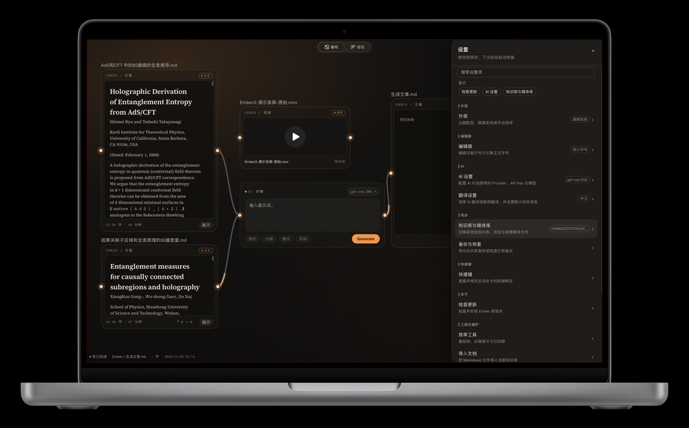

# Ember

本地优先、以画布为中心的 Markdown 笔记应用。基于 Tauri 2 + Rust + React 19 + TypeScript，知识库以明文 `.md` 保存在本机，画布用于把文档、媒体与 AI 步骤组织成可复用流程。

[](docs/assets/docs:assets:ember2-demo-poster.jpg)

## 功能

- **画布工作流**：文档、媒体与 AI 步骤作为节点，通过端口连线组合成流程
- **明文知识库**：Markdown 为唯一真相源，支持 wiki 链接、标签与反链
- **看板**：KPI、八维覆盖、修改热力图、趋势、分布分析、时间线与知识网络
- **编辑与整理**：多库管理、导入、全文替换、历史版本、回收站、备份与健康检查
- **媒体与 AI**：图片/附件管理、AI 浮窗、翻译
- **桌面体验**：命令面板、可自定义快捷键、窗口平铺/层叠、应用内更新
- **启动即用**：首次启动自动创建并打开默认画布 `Zero`

## 快速上手

1. 首次启动会自动创建并打开默认画布 `Zero`。左侧是知识库文档树，中间是无限画布，右上是画布/看板切换与设置。
2. 新建内容：画布空白处右键「创建新文章」，会在库根创建空文章并挂一个文档节点；也可以从左侧文档树拖文档进画布。
3. 连线：从节点左右两侧的橙色端口拖出连线，落到另一个节点即可连接；拖到空白处松手，会弹出菜单，选「创建新文章 / 文本 / AI / 提示词」可新建节点并自动连边。
4. 看板：右上切到看板后，顶部可选「全部 / 30 天 / 90 天 / 182 天」范围；KPI、修改热力图、趋势、知识网络和「建议处理」会联动，点建议条可跳到对应区域。
5. 外观与阅读：右上齿轮 → 外观，可切换主题、编辑器行号与正文字号（较小/默认/较大/特大）；顶栏空白区域不再拦截画布操作，拖动窗口请抓顶部窄条。

## 下载安装

从 [Releases](https://github.com/TheViviana/Ember2/releases) 下载最新的 Universal DMG（Apple Silicon + Intel），拖入「应用程序」即可。

安装包使用 ad-hoc 签名、未做 Apple 公证。若首次打开被 Gatekeeper 拦截，可右键选择「打开」，或执行：

```bash
xattr -dr com.apple.quarantine /Applications/Ember.app
```

## 本地开发

环境要求：macOS、Xcode Command Line Tools、Node.js >= 22.18.0、pnpm 12、Rust stable。

```bash
pnpm install
pnpm tauri dev
```

质量检查与测试：

```bash
pnpm test          # node --test
pnpm run typecheck
pnpm run lint
pnpm run gate
pnpm run check     # 前端全量 + Rust（fmt/check/clippy/test/audit）
```

构建 Universal 安装包：

```bash
pnpm tauri build --target universal-apple-darwin
```

产物位于 `src-tauri/target/universal-apple-darwin/release/bundle/`。

## 目录结构

```text
src/app      应用壳、画布引擎、面板与窗口管理
src/core     领域模型与本地存储
src/features 功能模块（看板、AI、媒体、历史、翻译等）
src-tauri    Rust 后端与 Tauri 配置
packages     canvas-format / doc-model 共享包
tests        node --test 测试
docs         架构契约与文件格式说明
```

## 数据与隐私

应用默认只读写本机知识库；AI、翻译与更新等功能按需访问网络。本仓库与安装包均不包含任何用户知识库数据。

## 许可证

本项目以 PolyForm Noncommercial 1.0.0 许可发布，详见根目录 [LICENSE](LICENSE)。

你可以将本项目用于个人学习、研究、兴趣爱好等非商业用途，包括修改与再分发（需保留 Required Notice: Copyright TheViviana 及许可证文本）。
商业使用需另行授权，请联系作者。
